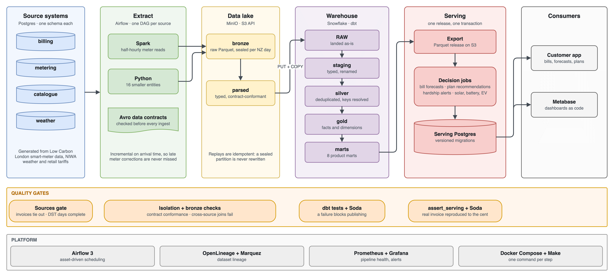
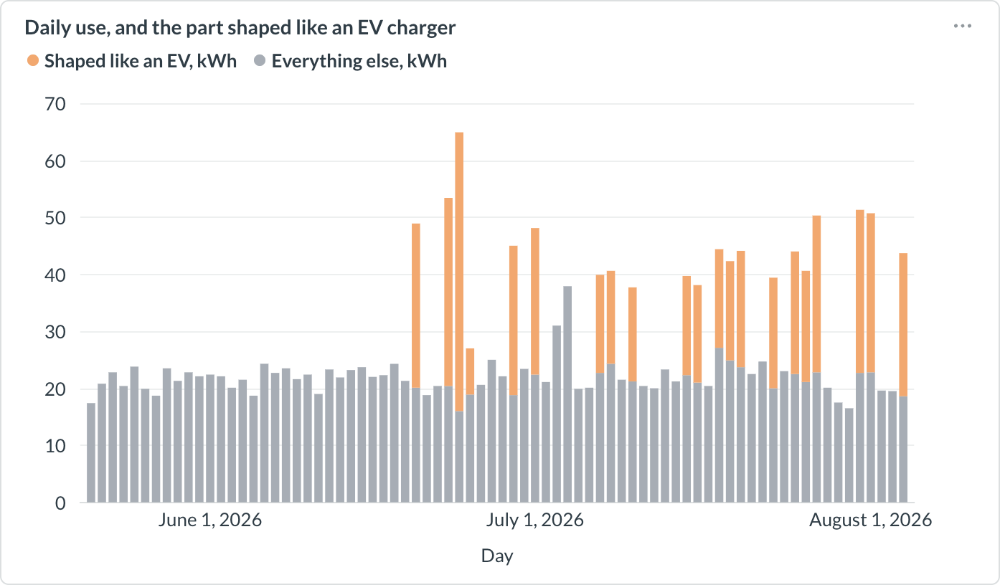
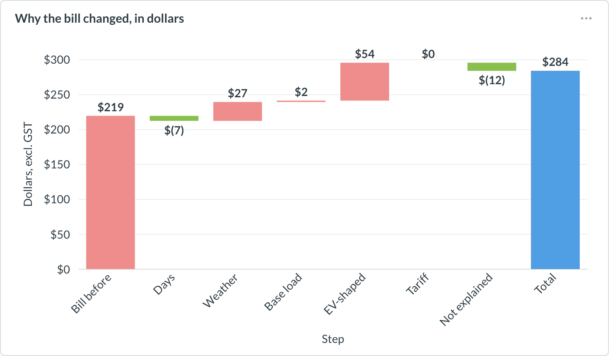
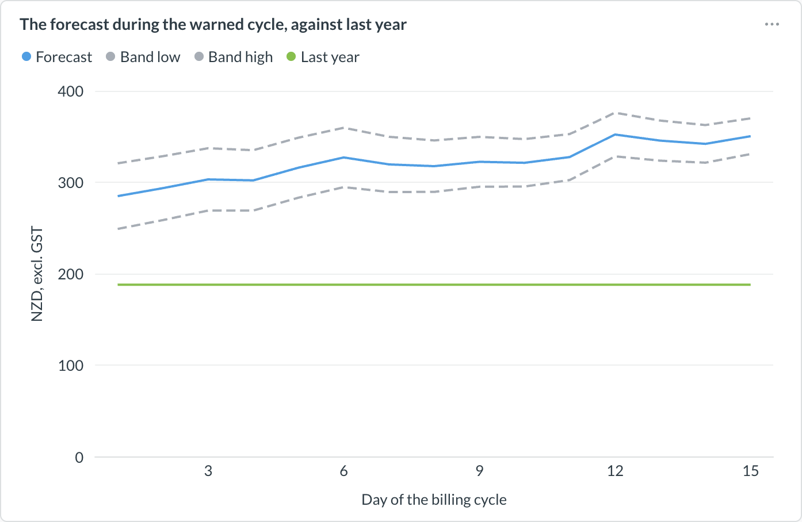
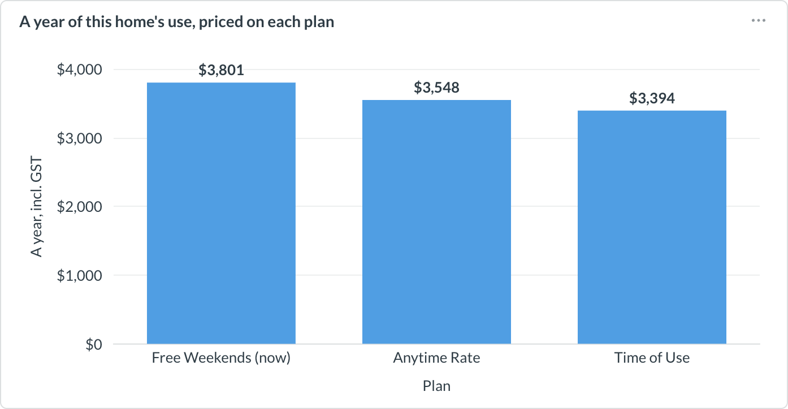
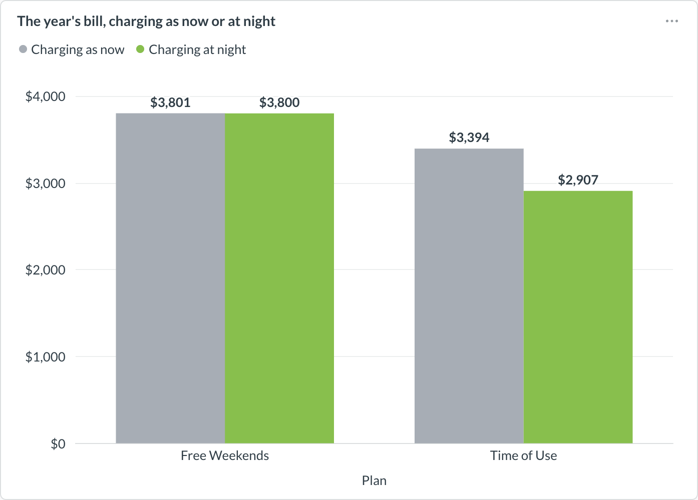
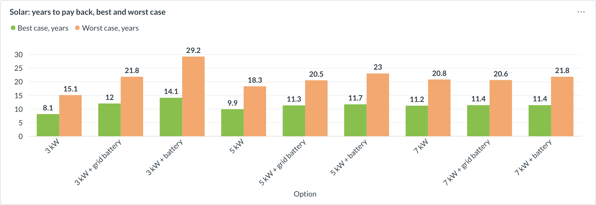

# Kea Energy — Data Platform

**A data platform that turns smart-meter readings into answers for New Zealand electricity
customers: why a bill went up, what it will come to, which plan is cheapest, and what charging
an EV at night or adding solar would save.**

## Why it matters

Three trends are making New Zealand households look harder at their power bills:

- **Bills keep rising:** up 6.8% on average in the first half of 2026, after 8.0% in 2025
  ([Electricity
  Authority](https://www.ea.govt.nz/news/general-news/data-shows-68-increase-to-power-bills-across-households-and-small-businesses/)).
- **More cars charge at home:** with petrol at $3.35 a litre, EV and plug-in hybrid
  registrations in the September quarter were up 206% on a year earlier, 19% of all car
  registrations ([Infometrics, via
  RNZ](https://newswire.co.nz/2026/10/new-zealand-electric-car-registrations-triple-september-quarter-2026/)).
- **More homes turn to solar:** just under 84,000 customers now have it, up from 20,000 in
  2018, and Rewiring Aotearoa estimates most buyers now save more than they spend
  ([RNZ](https://www.rnz.co.nz/news/business/594242/new-zealand-passes-solar-tipping-point)).

That leaves customers with five questions: why the bill went up, what it will come to, and
whether another plan, charging the car at night or adding solar would save money.
[Analysis](#analysis) answers each one for a demo household.

Answering them needs half-hourly meter data, billing history, tariffs and weather from separate
systems, and the answers have to be correct. This pipeline collects that data, models it and
publishes it to the customer-facing app in tested releases.

## Data sources

The data is generated from real public datasets, so it behaves like real data but contains
no customer information.

| Source | Used for |
|---|---|
| [Low Carbon London](https://www.kaggle.com/datasets/jeanmidev/smart-meters-in-london) smart-meter data | A deterministic 200-household cohort, shifted to NZ time and seasons ([details](dictionary/lcl-source-data.md)) |
| [NIWA](dictionary/niwa-weather-source.md) daily temperatures | Heating-degree days for weather-adjusted forecasts (non-commercial licence, not redistributed) |
| [Retail tariffs](dictionary/ecotricity-tariff-source.md) | Three plan families used to price every bill |
| [`sample/`](sample/) | Nine hand-built households, each a "why did my bill go up" scenario that checks its own totals |

**Dollar figures are illustrative.** Tariffs come from public sources; values that had to be
assumed are marked as such in the data dictionary.

## Architecture



1. **Sources.** Four Postgres systems (billing, metering, catalogue, weather) are generated
   from public data and include deliberate defects and late meter corrections.
2. **Extract.** Each source system has its own Airflow DAG and least-privilege database role.
   Spark handles the half-hourly meter reads and plain Python handles the 16 smaller entities.
   Extracts are incremental on arrival time, so late corrections are picked up.
3. **Lake.** Data lands as Parquet on S3-compatible storage, sealed per New Zealand day and
   checked against Avro contracts.
4. **Warehouse.** Data is loaded into Snowflake, then modelled by dbt through staging →
   silver → gold → marts, with tests at each layer.
5. **Serve.** Marts are exported as a release and published to the app's Postgres. In the
   same transaction, decision jobs compute bill forecasts, plan recommendations, hardship
   alerts and solar, battery and EV estimates.
6. **Analyse.** Metabase dashboards read the published data. Every dashboard is built from
   code and each card is checked on every build (`make dashboards`).

## Analysis

The published data answers the questions above. These charts come from the demo walkthrough
dashboard, which follows one household from the test data through each feature below. The data
is synthetic and the dashboard shows no identifiers.

| Question | Answer for the demo household |
|---|---|
| [Why did my bill go up?](#why-did-my-bill-go-up) | Up 29%, mostly a new EV: $54 of the $64 rise |
| [What will this bill come to?](#what-will-this-bill-come-to) | Up to 87% above last year, so a warning from day one |
| [Would another plan be cheaper?](#would-another-plan-be-cheaper) | Yes: Time of Use, about $400 a year less |
| [What if the car charged at night?](#what-if-the-car-charged-at-night) | Another $487 a year on Time of Use |
| [What if the household added solar?](#what-if-the-household-added-solar) | Fastest payback 8 to 15 years (3 kW, no battery) |

Each section gives the result first; open **How it's calculated** for the method.

### Why did my bill go up?

The bill for 2 Jun – 1 Jul 2026 was **29% higher** than the one before ($219 → $284). The
EV-shaped load accounts for **$54** of the $64 rise and colder weather for $27, while a shorter
billing period saves $7. The $12 that no measured cause explains is shown rather than hidden.
From 20 June, the half-hourly data shows long evening blocks shaped like an EV charger:





<details>
<summary>How it's calculated</summary>

The bill explanation splits the change into causes and prices each one in dollars, at the
earlier bill's own price per kWh so the customer can check it against that bill. The causes are
measured in a fixed order, each after the ones before it are taken out:

1. **Days:** a longer or shorter billing period.
2. **Weather:** the change in heating degree days, times how much more this household uses on a
   colder day.
3. **Base load:** a change in the always-on use, such as fridges and standby.
4. **Detected loads:** EV-shaped and water-heater-shaped runs found in the half-hourly data.
5. **Tariff:** a change in the plan's prices.

Whatever is left is shown as **not explained**, so the parts always add up exactly to the
change. A bill is only called explained when the measured causes cover at least 60% of it and
both periods have complete weather.

</details>

### What will this bill come to?

During the cycle that started on 2 Sep 2026, the forecast sat up to **87% above** the same
period last year from day one, and its range never came down to last year's bill. Because it
was 15% or more above last year, the customer got a "heading unusually high" warning weeks
before the bill arrived.



<details>
<summary>How it's calculated</summary>

Partway through a billing cycle, the forecast is rebuilt as each day's meter reads arrive:

1. **Use so far** comes from the meter, so it is known, not estimated.
2. **The remaining days** are projected from a model fitted on this household's own past
   months: a daily base use plus the extra use per heating degree day. Detected loads such as
   the EV are added back, and the weather still to come is taken from 30-year climate normals
   for the region.
3. **The bill** is that use priced at the plan's rates, plus the daily charges. The ±15% range
   applies to the projected days only, because the metered days are already known.

</details>

### Would another plan be cheaper?

Over a year of this household's use (Aug 2026 – Aug 2027; the synthetic data runs to August
2027), **Time of Use** costs about **$400 a year less** than its current Free Weekends plan.
The household uses 55% of its power off-peak or at night, and only 5% in Free Weekends' free
hours, so Time of Use averages 30.7c/kWh against 34.8c.

Every household can choose from three [plans](dictionary/ecotricity-tariff-source.md). Prices
include GST, and all three pay 8c/kWh for exported solar:

| Plan | Energy price | Daily charge |
|---|---|---|
| **Anytime Rate** | 32.5c/kWh at any time | $1.45 |
| **Time of Use** | 39.0c/kWh peak (7–11am, 5–9pm), 27.0c off-peak (11am–5pm, 9–11pm), 18.0c night (11pm–7am), every day | $1.50 |
| **Free Weekends** | 36.5c/kWh, but free on Saturdays and Sundays from 9am to 5pm | $1.55 |



<details>
<summary>How it's calculated</summary>

The comparison re-prices the household's own use on every plan:

1. **A year of half-hourly use** is summed by weekday and half-hour of the day. This loses
   nothing, because every plan's price depends only on the weekday and the time of day.
2. **Each plan prices that use** with the same pricing engine, plus its daily charges. The
   current plan is re-priced the same way rather than taken from past bills, so any difference
   comes from the plan alone.
3. **A switch is recommended only when the plan itself is cheaper.** Term credits ($10 a month
   on a 6-month term, $25 a month on a 12-month term) can change which offer ranks first, but
   never turn a more expensive plan into a "saving".

</details>

### What if the car charged at night?

On Time of Use, charging at night would cut the bill by another **$487 a year** ($3,394 →
$2,907). On Free Weekends it saves almost nothing, because that plan has no cheaper night rate.
This is a modelled what-if, not a measurement.



<details>
<summary>How it's calculated</summary>

The what-if moves the charging this household already does, and re-prices the same year:

1. **Each detected charging session** is taken at the lower end of its estimated kWh, the part
   the detector is sure of, spread evenly over the session's half-hours. The rest of the
   household's evening use stays where it is.
2. **The session is moved to start at 11pm the same night.** Exactly the energy taken off is
   put back; a session that already starts at night stays put.
3. **The whole year is re-priced** with the charging as it happened and with it moved, on the
   current plan and on Time of Use. The difference is the saving.

</details>

### What if the household added solar?

Nine options were priced: 3, 5 and 7 kW, each without a battery, with a 13.5 kWh battery
charged from the panels, and with one that also charges from the grid when power is cheapest.
The fastest payback is a 3 kW system with no battery, at **8 to 15 years**, and a battery
lengthens the best case for every size. Installed costs and regional yields come from an
assumptions file, and no panel wear or price change is modelled, so these are estimates, not
measurements.



<details>
<summary>How it's calculated</summary>

Each option is worked out on this household's own year of half-hourly use:

1. **Panel output** for each day is the region's solar yield for that month, per kW, times the
   system size, spread over the daylight hours along the sun's arc. It is done twice, with a
   low and a high yield.
2. **Each real half-hour is netted on its own.** The panels first cover that half-hour's use,
   and only the surplus is exported at 8c/kWh. With a battery, the surplus charges the battery
   first, and the battery then covers later use.
3. **The year is priced on the household's current plan** with and without solar. The
   difference is the yearly saving.
4. **Payback is the installed cost divided by the yearly saving.** The best case is the low
   cost over the high saving, the worst case the high cost over the low saving.

</details>

## Tech stack

| Layer | Tool | Why |
|---|---|---|
| Orchestration | Airflow 3.3 | Data-aware scheduling: the daily pipeline starts when its source data has landed, not at a fixed time |
| Processing | Spark 3.5, Python | Spark only for the millions of meter reads; small tables don't justify a cluster |
| Lake | MinIO, Parquet, Avro | Runs locally with the same S3 API as AWS; Avro contracts catch schema drift before ingest |
| Warehouse | Snowflake, dbt 1.12 | Layered, version-controlled SQL models with built-in tests and docs |
| Serving | Postgres 16 | The app's own database; schema changes go through immutable, versioned migrations |
| Data quality | dbt tests, Soda Core | Tests the logic during the build and checks the data after each load |
| Observability | OpenLineage + Marquez, Prometheus + Grafana | Table-level lineage plus pipeline health and alerting |
| Analytics | Metabase | Dashboards built from code, with every card checked automatically |

## Getting started

**Prerequisites:** Docker, GNU Make, Python 3.11, a Snowflake account (set up once with
[`snowflake/bootstrap.sql`](snowflake/bootstrap.sql)), a [Kaggle API
token](https://www.kaggle.com/settings) to download the meter data, and the four NIWA daily
temperature datasets in `raw/niwa/` (a free, licence-gated download; see the [weather
dictionary](dictionary/niwa-weather-source.md)). Without the NIWA files the pipeline still
runs, but forecasts and bill explanations have no weather.

```bash
git clone https://github.com/nanhangfei/kea-energy-data.git && cd kea-energy-data
cp .env.example .env      # fill in passwords and Snowflake key-pair auth;
                          # add KAGGLE_USERNAME and KAGGLE_KEY
make ci                   # offline checks; needs no .env or credentials
make serving-db           # the app's Postgres, which releases publish into
make rebuild-all          # the whole pipeline end to end (~23-37 min)
```

Or run it one step at a time. Each command calls the same scripts as the Airflow DAG:

| Step | Command | What it does |
|---|---|---|
| Stack | `make up`, `make serving-db` | Start the local platform and the serving database |
| Sources | `make init-sources` | Generate and load the four source systems |
| Lake | `make ingest-date LOAD_DATE=2026-08-25` | Extract one NZ day from every source |
| Warehouse | `make build-warehouse` | Load Snowflake and run `dbt build` |
| Serving | `make publish-serving RELEASE=r1` | Publish one release with its decisions |
| Analysis | `make dashboards` | Rebuild the Metabase dashboards |

Local UIs: Airflow [:8080](http://localhost:8080), Metabase [:3002](http://localhost:3002),
Grafana [:3001](http://localhost:3001), Marquez [:3000](http://localhost:3000).
`make help` lists every command and option.

## Testing and data quality

| Command | What it checks |
|---|---|
| `make ci` | Lint, unit tests, migrations, dbt parse and DAG imports, offline |
| `make ingest-date VERIFY=1` | The lake: an idempotent replay, contract conformance, and that a billing outage leaves metering unaffected |
| `make run-pipeline VERIFY=1` | Failure paths end to end, for example that a failing dbt test leaves the served data unchanged |

Every step ends with a gate that fails the run: source integrity, lake isolation, `dbt test`
plus Soda on the warehouse, and `assert_serving` plus Soda on the published release.

## Project structure

```
pipeline/
  airflow/dags/      one extract DAG per source, the daily pipeline, forecast refresh
  spark_jobs/        meter-read extract and parse
  contracts/avro/    data contracts for all 17 source entities
  dbt_project/       staging → silver → gold → marts, with tests
  export/            one SQL file per served table
  scripts/           loaders, publisher, decision jobs, gates, data generation
  soda/              warehouse and serving checks
migrations/serving/  versioned schema migrations for the serving database
design/              architecture docs, DDL and the pipeline diagram
dictionary/          source datasets: meaning, units, quirks, provenance
analysis/            dashboards as code, dashboard screenshots, evaluations
```

## Roadmap

| Stage | What it delivers | Status |
|---|---|---|
| **1. Platform foundation** | Local stack; four source systems generated from real data, with planted defects; per-source extracts into an S3 lake with Avro contracts; Snowflake + dbt warehouse; atomic publishing into the app's Postgres | Done |
| **2. Quality and operations** | dbt tests, Soda checks and a serving gate that reproduces a real printed bill to the cent; lineage in Marquez; pipeline health and alerting in Grafana; asset-driven Airflow orchestration with backfill | Done |
| **3. Core customer features** | Bill explanation, mid-cycle bill forecast and warning, plan comparison, hardship signals with staff alerts | Done |
| **4. Advanced analytics** | EV and water-heater load detection; solar, battery and EV what-ifs; hardship early warning; each scored against planted answers | Done |
| **5. Analysis and scale** | 200-household cohort; Metabase dashboards built from code; pinned versions and offline CI checks (`make ci`) | Done |
| **6. Delivery** | CI on every pull request, including `dbt build` in an isolated schema; first run of the guarded `make deploy` | In progress |
| **7. Production readiness** | Immutable export releases with a manifest; deployment to AWS (MWAA, EMR Serverless, RDS) with infrastructure as code | Planned |
| **8. Streaming** | Meter reads replayed through Kafka and Flink, proven to produce the same marts as batch | Planned |

## About this repository

This repository is extracted from **Kea**, a team project developed in
`CS778-S2-2026-AWS-Challenge/HAKAS-kea-energy` (private). I was the team's data engineer.
This repository contains only the part I was responsible for: the data pipeline from the
source systems to the published serving database, and the analysis built on it. The app's
API and its web and mobile front ends, which read the served data, remain in the original
repository.

## Documentation

- [Platform design](design/kea-data-platform-design.md): what the pipeline does and the reasoning behind each design choice
- [Engineering stack](design/kea-data-engineering-stack.md): tools, versions and build order
- [Cohort selection](design/kea-cohort-selection.md): how the 200 households were chosen
- [Serving migrations](migrations/serving/README.md): first run, baseline and recovery
